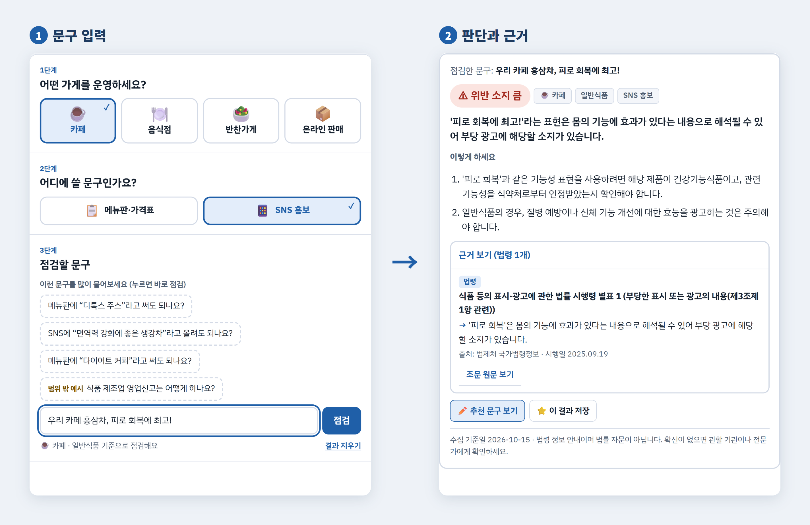
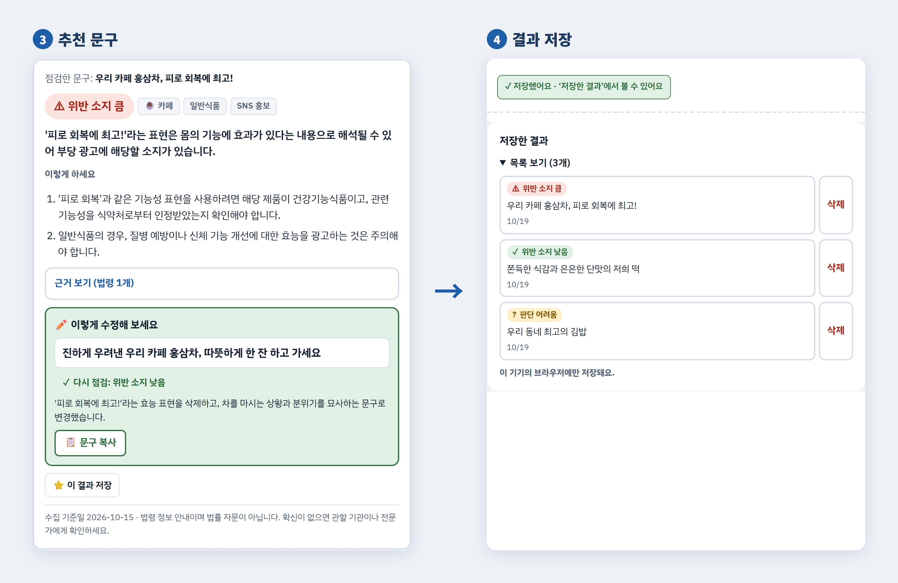
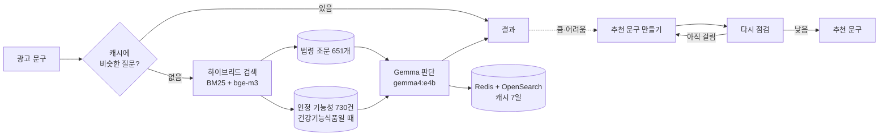

# 식품 표시·광고 도우미

카페·음식점·반찬가게 사장님과 온라인 식품 판매자를 위한 **광고 문구 점검 도우미**입니다.
메뉴판·상세페이지·SNS에 쓸 문구를 넣으면, 법에 걸릴 수 있는지 **근거 조문과 함께** 알려 주고
문제가 있으면 **다시 점검해서 안전한 문구**를 추천합니다.

   
  

> 법률 자문이 아닌 참고용 안내입니다. "위법입니다"처럼 단정하지 않습니다.

## 주요 기능

### 1. 세 단계로 쉽게 입력
가게 종류(카페·음식점·반찬가게·온라인 판매) → 쓸 곳(메뉴판·가격표 / 상세페이지 / SNS 홍보) → 문구 순서로 고릅니다.
가게마다 예시 문구가 있어 눌러 보기만 해도 점검할 수 있습니다.

### 2. 판단 4단계와 근거
| 판단 | 뜻 |
|---|---|
| ⚠ 위반 소지 큼 | 조문에 비추어 문제 될 가능성이 높음 |
| ? 판단 어려움 | 맥락이나 제품 정보가 더 필요함 (예: "최고", "100%", "무첨가") |
| ✓ 위반 소지 낮음 | 맛·식감·분위기를 그리는 평범한 표현 |
| – 범위 밖 | 이 도우미가 점검하지 않는 질문 |

근거는 접어 두었다가 "근거 보기"로 펼칩니다. 각 근거에 **출처**(법제처 / 식약처 식품안전나라 인정 제N호)와
**쉬운 말 한 줄 설명**이 있고, 필요하면 **조문 원문**까지 볼 수 있습니다.

### 3. ✏️ 추천 문구
위반 소지가 크거나 판단이 어려울 때만 "추천 문구 보기" 버튼이 나옵니다.
누르면 효능 표현을 빼고 원료·맛·만드는 방법·분위기로 고친 문구를 만들고,
**같은 기준으로 다시 점검해서 '위반 소지 낮음'이 나온 문구 하나만** 보여 줍니다 (보통 5초 안팎).
원래 문구에 없는 원산지·재료·만드는 때 같은 사실은 지어내지 않습니다.

### 4. 결과 저장과 휴대폰 화면
"⭐ 이 결과 저장"을 누르면 이 기기의 브라우저에 저장되어 "저장한 결과"에서 다시 볼 수 있습니다 (추천 문구 포함).
휴대폰에서는 같은 와이파이에서 `http://PC주소:5000`으로 열 수 있습니다.

## 동작 흐름

- **근거 자료:** 식품표시광고법·식품위생법·건강기능식품법 등 법률·시행령·시행규칙 8개와 식약처 고시 2개(법제처 OpenAPI),
  식약처 건강기능식품 인정 기능성(식품안전나라)
- **같은 문구는 같은 판단:** Gemma의 seed를 고정해, 같은 문구를 다시 넣어도 판단이 바뀌지 않습니다.

## 사용 기술

| 구분 | 사용 |
|---|---|
| 검색 | OpenSearch 3.3 (neural-search, 한국어 cjk 분석기, 하이브리드 검색) |
| 임베딩 · 답변 | Ollama — bge-m3, gemma4:e4b (RTX A2000 12GB) |
| 캐시 | Redis 7.2 (답변), OpenSearch (비슷한 질문 찾기) |
| 서버 · 화면 | FastAPI, HTML·CSS·JavaScript (한 파일) |

## 준비

1. `pip install -r requirements.txt`
2. `.env.example`을 `.env`로 복사하고 `LAW_OC`, OpenSearch·Redis 값을 넣습니다.
   - `OLLAMA_HOST`는 `http://127.0.0.1:11434`로 둡니다. `localhost`로 쓰면 IPv6부터 시도해서 호출마다 약 2초 늦어집니다.
3. OpenSearch(neural-search 플러그인 포함), Redis, Ollama를 실행하고 모델을 받습니다.

       ollama pull bge-m3
       ollama pull gemma4:e4b

## 데이터 만들기 (처음 한 번, 이후 월 1회)

    python scripts/run_monthly.py

단계별로 실행하려면:

    python scripts/collect/collect_law.py        # 법률·시행령·시행규칙 8개 (--offline: data/law 저장본 사용)
    python scripts/collect/collect_admrul.py     # 식약처 고시 2개
    python scripts/collect/index_materials.py    # 식약처 인정 기능성 (인정번호 없는 1건 제외 730건)
    python scripts/rag/embed_index.py            # 두 인덱스 임베딩

식품안전나라 원본을 다시 받아야 할 때만: `FOODSAFETY_KEY`를 넣고 `python scripts/collect/fetch_foodsafety.py` → `python scripts/collect/build_materials.py`.

수집 이력: `logs/collect.jsonl`(실행 결과), `logs/law_history.jsonl`(조문 변경).

## 실행

    python scripts/rag/rag_server.py

- 화면: http://localhost:5000
- API 문서: http://localhost:5000/docs
  - `POST /rag/query` 문구 점검, `POST /rag/suggest` 추천 문구

## 테스트와 평가

    python -m pytest                     # 단위 테스트 (OpenSearch·Ollama 없이)
    python eval/eval_retrieval.py        # 검색 방식별 hit@5 → eval/report_retrieval.md
    python eval/eval_answers.py          # 답변 지표 (서버 실행 중) → eval/report_answers.md

## 문서

- 개요: [docs/식품 표시·광고 점검 도우미 개요서.md](docs/식품%20표시·광고%20점검%20도우미%20개요서.md)
- 설계: [docs/design/2026-10-15-food-ad-helper-design.md](docs/design/2026-10-15-food-ad-helper-design.md)

## 폴더

- `scripts/collect/` 수집·적재, `scripts/rag/` 검색·답변·추천·서버, `scripts/common/` 공통
- `web/` 화면, `eval/` 평가 문구와 스크립트, `tests/` 단위 테스트
- `data/law/` 법제처 원본, `data/foodsafety/` 식품안전나라 원본과 정제본
- `docs/images/` README 화면 캡처
